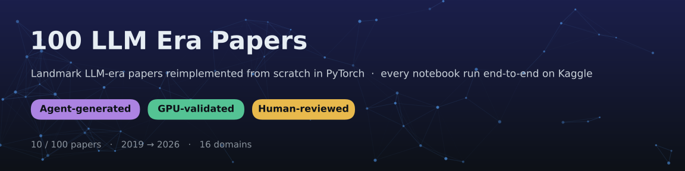
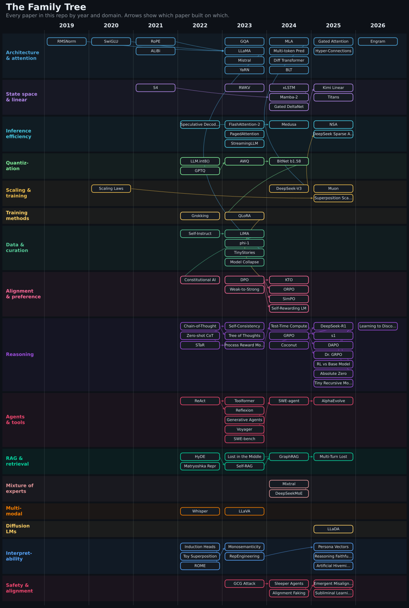

  
  
  
  

**100 landmark papers from the LLM era**, from RMSNorm (2019) to Engram and Learning to Discover (2026), each turned into a small, runnable, from-scratch PyTorch reimplementation with a plain-English explainer. Every notebook in this repo was **executed top to bottom on Kaggle** and is published with its real outputs, so you can open it, see it work, and fork it on a free GPU.

## How it's made: agent-generated, GPU-validated, human-reviewed

This repo is also an experiment in what AI agents can build when the bar is *"it actually runs."*

1. **Curated list:** I picked 100 landmark LLM-era papers and wrote, for each one, a spec of what its notebook should demonstrate.
2. **Agent-generated:** an AI agent reads the paper, writes the from-scratch implementation, and drafts the explainer docs.
3. **GPU-validated:** every notebook is pushed to Kaggle and run end-to-end, on a T4 GPU or on CPU for the small ones. A notebook ships only if every cell runs with zero errors, and the executed version, with its outputs, is what gets committed.
4. **Human-reviewed:** I review the code, results and claims before publishing, and re-run or rewrite the notebooks whose results don't hold up.

> **Scaled down on purpose.** These are teaching-sized reproductions: small models, synthetic or small datasets, minutes of training instead of days. They show *how* each idea works and reproduce the qualitative effect, not the paper's headline numbers. Each `CODE_ARCHITECTURE.md` lists the simplifications made.

## The family tree

## What's in each folder

| File | What it gives you |
|---|---|
| `README.md` | A 5-minute read: summary, core idea, key method details, influence, and the problem explained like you're 10 |
| `solution.ipynb` | The from-scratch implementation, executed on Kaggle with all outputs |
| `CODE_ARCHITECTURE.md` | A guided walkthrough of the notebook: data flow, tensor shapes, and simplifications vs. the paper |
| `TALK.md` | Coverage, Q&A answered from the paper, common misconceptions, and citations |

## Papers by domain

[Architecture & Attention](#architecture--attention) · [State Space & Linear Models](#state-space--linear-models) · [Inference Efficiency](#inference-efficiency) · [Quantization](#quantization) · [Scaling Laws & Training](#scaling-laws--training) · [Training Methods](#training-methods) · [Data & Curation](#data--curation) · [Alignment & Preference](#alignment--preference) · [Reasoning](#reasoning) · [Agents & Tools](#agents--tools) · [RAG & Retrieval](#rag--retrieval) · [Mixture of Experts](#mixture-of-experts) · [Multimodal](#multimodal) · [Diffusion LMs](#diffusion-lms) · [Interpretability](#interpretability) · [Safety & Alignment](#safety--alignment)

### Architecture & Attention

| # | Year | Paper | Run it |
|---|---|---|---|
| 004 | 2019 | [Root Mean Square Layer Normalization (RMSNorm)](004_rmsnorm-root-mean-square-layer-norm/) |  |
| 003 | 2020 | [GLU Variants Improve Transformer (SwiGLU)](003_swiglu-glu-variants-improve-transformer/) |  |
| 001 | 2021 | [RoFormer: Enhanced Transformer with Rotary Position Embedding](001_roformer-rotary-position-embedding/) |  |
| 002 | 2021 | [Train Short Test Long: Attention with Linear Biases (ALiBi)](002_alibi-attention-with-linear-biases/) |  |
| 005 | 2023 | [GQA: Training Generalized Multi-Query Transformer Models](005_gqa-generalized-multi-query-attention/) |  |
| 006 | 2023 | [LLaMA: Open and Efficient Foundation Language Models](006_llama-open-and-efficient-foundation-language-models/) |  |
| 007 | 2023 | [Mistral 7B](007_mistral-7b-sliding-window-attention/) |  |
| 008 | 2023 | [YaRN: Efficient Context Window Extension of Large Language Models](008_yarn-efficient-context-window-extension/) |  |
| 009 | 2024 | [DeepSeek-V2: Multi-head Latent Attention (MLA)](009_deepseek-v2-multi-head-latent-attention/) |  |
| 010 | 2024 | [Better and Faster LLMs via Multi-token Prediction](010_multi-token-prediction-llms/) |  |
| 011 | 2024 | [Differential Transformer](011_differential-transformer/) |  |
| 015 | 2024 | [Byte Latent Transformer: Patches Scale Better Than Tokens](015_byte-latent-transformer/) |  |
| 012 | 2025 | [Gated Attention for Large Language Models](012_gated-attention-llm/) |  |
| 013 | 2025 | [mHC: Manifold-Constrained Hyper-Connections](013_mhc-manifold-constrained-hyper-connections/) |  |
| 014 | 2026 | [Conditional Memory via Scalable Lookup (Engram)](014_engram-conditional-memory-scalable-lookup/) |  |

### State Space & Linear Models

| # | Year | Paper | Run it |
|---|---|---|---|
| 016 | 2021 | Efficiently Modeling Long Sequences with Structured State Spaces (S4) | _In progress_ |
| 019 | 2023 | RWKV: Reinventing RNNs for the Transformer Era | _In progress_ |
| 017 | 2024 | xLSTM: Extended Long Short-Term Memory | _In progress_ |
| 018 | 2024 | Transformers are SSMs: Generalized Models via Structured State Space Duality | _In progress_ |
| 020 | 2024 | Gated Delta Networks: Improving Mamba2 with Delta Rule | _In progress_ |
| 021 | 2025 | Kimi Linear: An Expressive Efficient Attention Architecture | _In progress_ |
| 022 | 2025 | Titans: Learning to Memorize at Test Time | _In progress_ |

### Inference Efficiency

| # | Year | Paper | Run it |
|---|---|---|---|
| 025 | 2022 | Fast Inference from Transformers via Speculative Decoding | _In progress_ |
| 023 | 2023 | FlashAttention-2: Faster Attention with Better Parallelism | _In progress_ |
| 024 | 2023 | Efficient Memory Management for LLM Serving with PagedAttention (vLLM) | _In progress_ |
| 027 | 2023 | Efficient Streaming Language Models with Attention Sinks | _In progress_ |
| 026 | 2024 | Medusa: Simple LLM Inference Acceleration with Multiple Decoding Heads | _In progress_ |
| 032 | 2025 | Native Sparse Attention: Hardware-Aligned and Natively Trainable | _In progress_ |
| 033 | 2025 | DeepSeek-V3.2: Pushing the Frontier of Open LLMs (DeepSeek Sparse Attention) | _In progress_ |

### Quantization

| # | Year | Paper | Run it |
|---|---|---|---|
| 028 | 2022 | LLM.int8(): 8-bit Matrix Multiplication for Transformers at Scale | _In progress_ |
| 029 | 2022 | GPTQ: Accurate Post-Training Quantization for Generative Pre-trained Transformers | _In progress_ |
| 030 | 2023 | AWQ: Activation-aware Weight Quantization for LLM Compression | _In progress_ |
| 031 | 2024 | The Era of 1-bit LLMs: All Large Language Models are in 1.58 Bits | _In progress_ |

### Scaling Laws & Training

| # | Year | Paper | Run it |
|---|---|---|---|
| 034 | 2020 | Scaling Laws for Neural Language Models (Kaplan) | _In progress_ |
| 035 | 2024 | DeepSeek-V3 Technical Report | _In progress_ |
| 036 | 2025 | Muon is Scalable for LLM Training | _In progress_ |
| 037 | 2025 | Superposition Yields Robust Neural Scaling | _In progress_ |

### Training Methods

| # | Year | Paper | Run it |
|---|---|---|---|
| 038 | 2022 | Grokking: Generalization Beyond Overfitting on Small Algorithmic Datasets | _In progress_ |
| 039 | 2023 | QLoRA: Efficient Finetuning of Quantized LLMs | _In progress_ |

### Data & Curation

| # | Year | Paper | Run it |
|---|---|---|---|
| 040 | 2022 | Self-Instruct: Aligning Language Models with Self-Generated Instructions | _In progress_ |
| 041 | 2023 | LIMA: Less Is More for Alignment | _In progress_ |
| 042 | 2023 | Textbooks Are All You Need (phi-1) | _In progress_ |
| 043 | 2023 | TinyStories: How Small Can Language Models Be and Still Speak Coherent English | _In progress_ |
| 044 | 2023 | The Curse of Recursion: Training on Generated Data Makes Models Forget | _In progress_ |

### Alignment & Preference

| # | Year | Paper | Run it |
|---|---|---|---|
| 045 | 2022 | Constitutional AI: Harmlessness from AI Feedback | _In progress_ |
| 046 | 2023 | Direct Preference Optimization: Your Language Model is Secretly a Reward Model | _In progress_ |
| 051 | 2023 | Weak-to-Strong Generalization: Eliciting Strong Capabilities With Weak Supervision | _In progress_ |
| 047 | 2024 | KTO: Model Alignment as Prospect Theoretic Optimization | _In progress_ |
| 048 | 2024 | ORPO: Monolithic Preference Optimization without Reference Model | _In progress_ |
| 049 | 2024 | SimPO: Simple Preference Optimization with a Reference-Free Reward | _In progress_ |
| 050 | 2024 | Self-Rewarding Language Models | _In progress_ |

### Reasoning

| # | Year | Paper | Run it |
|---|---|---|---|
| 052 | 2022 | Chain-of-Thought Prompting Elicits Reasoning in Large Language Models | _In progress_ |
| 053 | 2022 | Large Language Models are Zero-Shot Reasoners | _In progress_ |
| 054 | 2022 | Self-Consistency Improves Chain of Thought Reasoning in Language Models | _In progress_ |
| 056 | 2022 | STaR: Bootstrapping Reasoning With Reasoning | _In progress_ |
| 055 | 2023 | Tree of Thoughts: Deliberate Problem Solving with Large Language Models | _In progress_ |
| 057 | 2023 | Let's Verify Step by Step (Process Reward Models) | _In progress_ |
| 058 | 2024 | Scaling LLM Test-Time Compute Optimally can be More Effective than Scaling Model Parameters | _In progress_ |
| 059 | 2024 | DeepSeekMath: Pushing the Limits of Mathematical Reasoning (GRPO) | _In progress_ |
| 065 | 2024 | Training Large Language Models to Reason in a Continuous Latent Space (Coconut) | _In progress_ |
| 060 | 2025 | DeepSeek-R1: Incentivizing Reasoning Capability in LLMs via Reinforcement Learning | _In progress_ |
| 061 | 2025 | s1: Simple test-time scaling | _In progress_ |
| 062 | 2025 | DAPO: An Open-Source LLM Reinforcement Learning System at Scale | _In progress_ |
| 063 | 2025 | Understanding R1-Zero-Like Training: A Critical Perspective (Dr. GRPO) | _In progress_ |
| 064 | 2025 | Does Reinforcement Learning Really Incentivize Reasoning Capacity Beyond the Base Model | _In progress_ |
| 066 | 2025 | Absolute Zero: Reinforced Self-play Reasoning with Zero Data | _In progress_ |
| 067 | 2025 | Less is More: Recursive Reasoning with Tiny Networks | _In progress_ |
| 068 | 2026 | Learning to Discover at Test Time | _In progress_ |

### Agents & Tools

| # | Year | Paper | Run it |
|---|---|---|---|
| 069 | 2022 | ReAct: Synergizing Reasoning and Acting in Language Models | _In progress_ |
| 070 | 2023 | Toolformer: Language Models Can Teach Themselves to Use Tools | _In progress_ |
| 071 | 2023 | Reflexion: Language Agents with Verbal Reinforcement Learning | _In progress_ |
| 072 | 2023 | Generative Agents: Interactive Simulacra of Human Behavior | _In progress_ |
| 073 | 2023 | Voyager: An Open-Ended Embodied Agent with Large Language Models | _In progress_ |
| 074 | 2023 | SWE-bench: Can Language Models Resolve Real-World GitHub Issues | _In progress_ |
| 075 | 2024 | SWE-agent: Agent-Computer Interfaces Enable Automated Software Engineering | _In progress_ |
| 076 | 2025 | AlphaEvolve: A coding agent for scientific and algorithmic discovery | _In progress_ |

### RAG & Retrieval

| # | Year | Paper | Run it |
|---|---|---|---|
| 077 | 2022 | Precise Zero-Shot Dense Retrieval without Relevance Labels (HyDE) | _In progress_ |
| 081 | 2022 | Matryoshka Representation Learning | _In progress_ |
| 078 | 2023 | Lost in the Middle: How Language Models Use Long Contexts | _In progress_ |
| 079 | 2023 | Self-RAG: Learning to Retrieve Generate and Critique through Self-Reflection | _In progress_ |
| 080 | 2024 | From Local to Global: A Graph RAG Approach to Query-Focused Summarization | _In progress_ |
| 082 | 2025 | LLMs Get Lost In Multi-Turn Conversation | _In progress_ |

### Mixture of Experts

| # | Year | Paper | Run it |
|---|---|---|---|
| 083 | 2024 | Mixtral of Experts | _In progress_ |
| 084 | 2024 | DeepSeekMoE: Towards Ultimate Expert Specialization in Mixture-of-Experts | _In progress_ |

### Multimodal

| # | Year | Paper | Run it |
|---|---|---|---|
| 086 | 2022 | Robust Speech Recognition via Large-Scale Weak Supervision (Whisper) | _In progress_ |
| 085 | 2023 | Visual Instruction Tuning (LLaVA) | _In progress_ |

### Diffusion LMs

| # | Year | Paper | Run it |
|---|---|---|---|
| 087 | 2025 | Large Language Diffusion Models (LLaDA) | _In progress_ |

### Interpretability

| # | Year | Paper | Run it |
|---|---|---|---|
| 088 | 2022 | In-context Learning and Induction Heads | _In progress_ |
| 089 | 2022 | Toy Models of Superposition | _In progress_ |
| 091 | 2022 | Locating and Editing Factual Associations in GPT (ROME) | _In progress_ |
| 090 | 2023 | Towards Monosemanticity: Decomposing Language Models With Dictionary Learning | _In progress_ |
| 093 | 2023 | Representation Engineering: A Top-Down Approach to AI Transparency | _In progress_ |
| 098 | 2025 | Persona Vectors: Monitoring and Controlling Character Traits in Language Models | _In progress_ |
| 099 | 2025 | Reasoning Models Don't Always Say What They Think | _In progress_ |
| 100 | 2025 | Artificial Hivemind: The Open-Ended Homogeneity of Language Models | _In progress_ |

### Safety & Alignment

| # | Year | Paper | Run it |
|---|---|---|---|
| 092 | 2023 | Universal and Transferable Adversarial Attacks on Aligned Language Models (GCG) | _In progress_ |
| 094 | 2024 | Sleeper Agents: Training Deceptive LLMs that Persist Through Safety Training | _In progress_ |
| 095 | 2024 | Alignment Faking in Large Language Models | _In progress_ |
| 096 | 2025 | Emergent Misalignment: Narrow finetuning can produce broadly misaligned LLMs | _In progress_ |
| 097 | 2025 | Subliminal Learning: Language models transmit behavioral traits via hidden signals | _In progress_ |

Year = first public release (usually arXiv). Numbers follow the order of the curated reading list.

## Watch: Backprop Daily

Short videos on the same 100 papers: *learn AI the way models learn, one step at a time.* They're made by an automated pipeline that writes the script, narrates it, generates the visuals and renders the video.

More at **[youtube.com/@BackpropDaily](https://www.youtube.com/@BackpropDaily?sub_confirmation=1)**.

## About me

I'm **Nadeem Sajjad**, a Senior AI Engineer and forward-deployed engineer with 12+ years across startups and scale-ups.

If this helped you understand a paper, a ⭐ helps others find it.

---

Licensed under the [MIT License](https://github.com/nadeemcite/llm-research-papers/blob/main/LICENSE). Generated by `scripts/build_readme.py` from `scripts/papers.tsv`; edit those, not this file.
